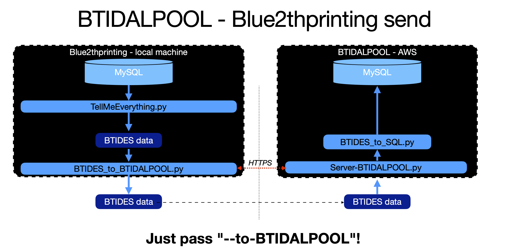

# BTIDALPOOL

The BTIDALPOOL is the server is where we *pool* our [BTIDES](https://github.com/darkmentorllc/BTIDES_Schema) data! It allows for crowdsourced upload/download of Bluetooth data in BTIDES format.

The current address is:
 - `https://btidalpool.ddns.net:7653` - For Google OAuth
 - `https://btidalpool.ddns.net:3567` - For [BTIDES](https://github.com/darkmentorllc/BTIDES_Schema) upload/download.
 - `https://btidalpool.ddns.net:3568/` - Rust BTPL v1 upload/download.
 - `https://btidalpool.ddns.net:3568/v2` - Rust BTPL v2 resumable upload.

## [Terms of Service](https://btidalpool.ddns.net:7653/tos)

## [Privacy Policy](https://btidalpool.ddns.net:7653/privacy)

## 1st party access

BTIDALPOOL can be used from Blue2thprinting tools by adding CLI arguments such as `--to-BTIDALPOOL` to upload, or `--query-BTIDALPOOL` to download.

**Uploaders:**
[`Tell_Me_Everything.py`]()
[`BTIDES_to_BTIDALPOOL.py`]()
[`PCAP_to_BTIDES.py`]()
[`HCI_to_BTIDES.py`]()

**Downloaders:**
[`Tell_Me_Everything.py`]()
[`BTIDALPOOL_to_BTIDES.py`]()

## 3rd party access

3rd party clients wishing to upload/download data have two options that currently run side by side:

* **Original Python implementation** — [`Analysis/BTIDES_to_BTIDALPOOL.py`](../Analysis/BTIDES_to_BTIDALPOOL.py) (upload) and [`Analysis/BTIDALPOOL_to_BTIDES.py`](../Analysis/BTIDALPOOL_to_BTIDES.py) (download). Reading `send_btides_to_btidalpool()` in the upload script (or `do_POST()` in [`Analysis/Server_BTIDALPOOL.py`](../Analysis/Server_BTIDALPOOL.py)) shows the legacy raw-JSON request/response shape.
* **Rust reimplementation** — the `btidalpool-client` binary built from [`BTIDALPOOL/`](../BTIDALPOOL/), or the equivalent Python shims at [`BTIDALPOOL/python/BTIDES_to_BTIDALPOOL.py`](../BTIDALPOOL/python/BTIDES_to_BTIDALPOOL.py) and [`BTIDALPOOL/python/BTIDALPOOL_to_BTIDES.py`](../BTIDALPOOL/python/BTIDALPOOL_to_BTIDES.py) (same function signatures as the originals, but shell out to the Rust binary). The Rust wire format (CBOR-encoded envelope inside a zstd-compressed frame, with explicit zip-bomb guards) is defined once in [`BTIDALPOOL/crates/btidalpool-proto/`](../BTIDALPOOL/crates/btidalpool-proto/) and is the same on client and server. See [`BTIDALPOOL/README.md`](../BTIDALPOOL/README.md) for the protocol details.

## Rate limits

The following limits are currently in effect:
 * Maximum number of requests per authenticated identity per rolling day: 100
 * Maximum simultaneous requests per authenticated identity: 10
 * A broader public-IP abuse limit also applies.
 * Maximum number of records returned per query: 100
 * Maximum BTIDES file upload size: 10MB

Throttled requests return HTTP 429 with a `Retry-After` header. V2 clients
should follow the complete contract in
[`BTIDALPOOL/V2_PROTOCOL.md`](../BTIDALPOOL/V2_PROTOCOL.md).

If you'd like to bypass these limits, you can email btidalpool at gmail to request Trusted Contributor status. This status is granted to researchers who provide a significant contribution of data to the BTIDALPOOL server.

## Invalid connection bans

The Python pool, Rust pool, and Google SSO listeners share a 24-hour IP ban
list. Invalid methods, routes, payloads, and credentials ban the peer IP.
The Python and SSO listeners also ban malformed TLS handshakes and close
subsequent connections before TLS negotiation. The Rust listener checks the
ban after TLS parsing but before spawning a request worker, returning 403.
Successful requests and application errors after authentication do not trigger
bans. Because the ban is per public IP, clients sharing a NAT address are
affected together.

All three services must be able to read and write the same SQLite file. Set
`BTIDALPOOL_BAN_DB` for the Python services and `--ban-db` for the Rust service
to configure its path; both default to `/tmp/btidalpool-ip-bans.sqlite3`. Run
the services as the same OS user, or provision a shared writable location.
Expired entries are removed on subsequent ban activity or when that IP
reconnects.

Copyright(c) © Dark Mentor LLC 2023-2026
