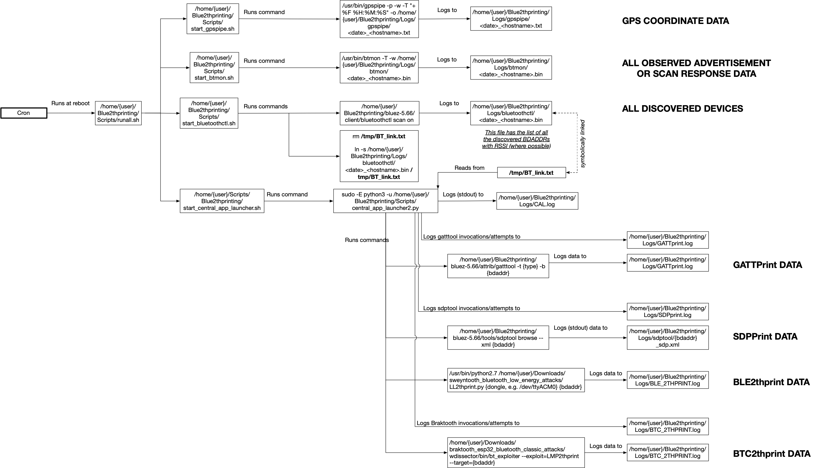

# Supported base OSes

* Laptop: Install *Ubuntu 24.04* into a **VMware** VM.
* Mini-PC: Install *Ubuntu 24.04* into host OS.
* Raspberry Pi Zero W: Install Raspbian ***Buster*** using the [Raspberry Pi Imager](https://www.raspberrypi.com/software/).

# OS Setup & Configuration

## Repository location

You may clone this repository to any path you like. The rest of the documentation uses `~/Blue2thprinting` for consistency, but that path is no longer required as it was in previous versions.

## Run the setup helper script

This previously was a bunch of manual commands. Now instead just run the below:

```
cd ~/Blue2thprinting
sudo ./setup_capture_helper_debian-based.sh
```

There are comments in that script if you want to see what's being done and why.

## Small hosts (Raspberry Pi Zero)

The setup helper also runs `Scripts/manage_capture_host_tuning.py`. It changes two host settings where they apply and nothing elsewhere, saves the file it is about to change under `/var/backups/blue2thprinting`, and does nothing on a repeat run. `sudo ./setup_capture_helper_debian-based.sh --tune-host` runs just this step, and `python3 Scripts/manage_capture_host_tuning.py --check` only reports what it would do.

* **One CPU core: a lower duty cycle for LE discovery scanning.** Every LE advertising report costs bluetoothd, dbus-daemon, btmon, `central_app_launcher.py` and anything else listening to BlueZ a round of work. Scanning all the time in a busy place takes more CPU than a Pi Zero has, and the collectors then cannot even start. So in `/etc/bluetooth/main.conf`, under `[LE]`, the discovery scan interval and window are set (units of 0.625 ms; this scans for 90 ms in every 300 ms):

  ```
  ScanIntervalDiscovery=480
  ScanWindowDiscovery=144
  ```

  bluetoothd reads this when it starts. The helper restarts it, unless capture is running, in which case the setting applies after the next reboot. Do not use a discovery RSSI filter for this instead: with one, the kernel reports every advertisement rather than each advertiser once per scan.

* **Less than 1 GB of RAM: a 2 GB swap file**, so that neither the compile stages of the setup nor several collectors running at once depend on fitting in a Pi Zero's 427 MB. How it is set depends on what manages swap:
  * `dphys-swapfile` (Raspberry Pi OS up to Bookworm): `CONF_SWAPSIZE=2048` in `/etc/dphys-swapfile`, and the swap file is rebuilt straight away.
  * `rpi-swap` (Raspberry Pi OS Trixie onwards, which otherwise gives a Pi Zero about 430 MB of compressed-RAM swap): a drop-in, `/etc/rpi/swap.conf.d/80-blue2thprinting-swapfile.conf`, with `Mechanism=swapfile` and `FixedSizeMiB=2048`. **It only takes effect at the next boot.** On such a Pi run `sudo ./setup_capture_helper_debian-based.sh --tune-host` and reboot *before* the full setup, so that the compile stages have the swap.

  It is skipped if the disk has too little free space, if a swap mechanism has already been chosen by hand, and on images that manage swap some other way.

One more thing helps on a single-core Pi and is not done by the setup helper, because it restarts networking: NetworkManager's Bluetooth plugin listens to every BlueZ D-Bus signal, and during capture took 11 to 17 % of a Pi Zero's CPU for nothing. A capture node does not use Bluetooth networking, so the plugin can be set aside (and later restored with `dpkg-divert --remove`):

```
PLUGIN=$(ls /usr/lib/*/NetworkManager/*/libnm-device-plugin-bluetooth.so | head -1)
sudo dpkg-divert --local --rename --divert "$PLUGIN.disabled" --add "$PLUGIN"
```

It stays loaded until NetworkManager next restarts (a reboot will do).

Run `sudo crontab -e` to review your crontab and confirm you only have a single instance of the `@reboot /home/user/Blue2thprinting/Scripts/runall.sh` command in it. If you ran the `setup_capture_helper_debian-based.sh` file multiple times, remove any extra instances of the `runall.sh` command.

# Capture Scripts Setup

### Setup automatic script execution at boot:

The previous `setup_capture_helper_debian-based.sh` should have already configured your system to automatically run data capture at reboot (which you should have confirmed with the `sudo crontab -e` above).

Before rebooting, run `hciconfig` and confirm you see at least one HCI Bluetooth interface (i.e. not empty output). If you don't, make sure you attach your USB Bluetooth dongle (if you don't have built-in Bluetooth passthrough capability from VMware), and attach that USB device to your VM.

Now reboot with `sudo reboot`.

After the system comes back up, run:
`~/Blue2thprinting/Scripts/check.sh`
(An alias to this command was installed in ~/.bashrc as just `c`.)
If you are too quick, you will see things like `start_btmon.sh`.
But after its sleep timer has expired, the steady state will look like:

```
root        1952  0.0  0.0   3636  1008 ?        S    18:02   0:00 /usr/bin/btmon -T -w /home/user/Blue2thprinting/Logs/btmon/2024-06-13-18-01-39_VM.bin
user        2034  0.0  0.0   9040   648 pts/0    S+   18:03   0:00 grep btmon
root         783  0.0  0.0   9500  3312 ?        S    18:01   0:00 /bin/bash /home/user/Blue2thprinting/Scripts/start_central_app_launcher.sh
root        1977  0.0  0.1  11924  4624 ?        S    18:02   0:00 sudo -E python3 -u /home/user/Blue2thprinting/Scripts/central_app_launcher.py
root        1979 97.9  0.3 168332 11936 ?        Sl   18:02   0:44 python3 -u /home/user/Blue2thprinting/Scripts/central_app_launcher.py
user        2038  0.0  0.0   9040   720 pts/0    S+   18:03   0:00 grep central_app
```

Discovery is performed in-process by `central_app_launcher.py` via the BlueZ D-Bus
API; the older `start_bluetoothctl.sh` background job is no longer wired into
`runall.sh` (see issue #47). The `start_bluetoothctl.sh` script is retained in
the `Scripts/` directory for ad-hoc diagnostic use.
From now on, whenever you reboot, the data collection will begin automatically.

You can cancel collection by running: `sudo ~/Blue2thprinting/Scripts/killall.sh`.

If you want to manually restart the collection without a reboot, you can run: `sudo ./runall.sh` from the Scripts folder.

### Novelty mode

`novelty_mode = True` near the top of `Scripts/central_app_launcher.py` (the default) makes the launcher skip devices whose advertisements already say what they are (Apple, Samsung, Android phones, vehicles, headphones and speakers, and names already fully GATT-enumerated), on both BLE and BTC, so that the radios' time goes to devices not seen before. Set it to `False` and restart the launcher to probe everything. [Novelty-mode.md](./Novelty-mode.md) describes the rules, the optional private rule files and how to copy them to a capture node, and the tests.

# Script interactions & data flow

Which scripts launch which other scripts, and what logs what data to where is captured in the below diagram (click for full size image.)



Copyright(c) © Dark Mentor LLC 2023-2026
